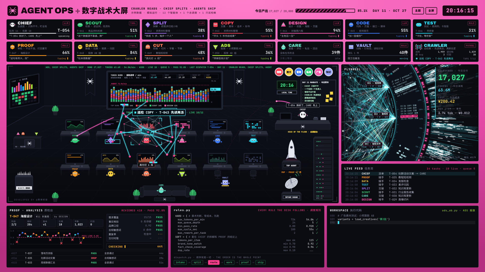

# Cyberdaddy Agent 战术大屏：来源与复用核对

核对日期：2026-10-27。本文只记录视觉来源、代码位置和授权事实；未把该项目源码或模拟业务接入当前产品。

## 来源与授权

对应候选为作者「赛博老爸」的 [cyberdaddyleo/agent-display](https://github.com/cyberdaddyleo/agent-display)。仓库只有 `index.html`、`README.md`、`CHANGELOG.md` 和 `LICENSE`；商业说明在 README 中，没有独立的 `COMMERCIAL.md`。

| 版本 | 已核实的授权 | 固定来源 |
| --- | --- | --- |
| v4.0，2026-10-21 | MIT；允许使用、修改和商业分发，需保留版权及许可声明 | [源码](https://github.com/cyberdaddyleo/agent-display/blob/b2f6cece9e3010b6a2fa09410b754101d87b9a0f/index.html)、[MIT LICENSE](https://github.com/cyberdaddyleo/agent-display/blob/b2f6cece9e3010b6a2fa09410b754101d87b9a0f/LICENSE) |
| 核对时最新 v8.0，2026-10-26 | PolyForm Noncommercial 1.0.0；非商业用途可用，商业用途需取得授权 | [固定版本 LICENSE](https://github.com/cyberdaddyleo/agent-display/blob/84e4e1143d4dba3fd06bcac2f66b5b0080dc90da/LICENSE)、[当前 LICENSE](https://github.com/cyberdaddyleo/agent-display/blob/main/LICENSE) |

v4 固定提交为 `b2f6cece9e3010b6a2fa09410b754101d87b9a0f`；核对时最新提交为 `84e4e1143d4dba3fd06bcac2f66b5b0080dc90da`。许可证在 [v5.0 提交](https://github.com/cyberdaddyleo/agent-display/commit/c812f0a97d7edf928001ddfa0708f1e854b53f4b)由 MIT 改为非商业许可。作者的[当前授权说明](https://github.com/cyberdaddyleo/agent-display#授权-license)明确保留旧版本按发布时许可证使用的规则。

当前授权说明将公司业务使用（含公司内部使用）、客户交付、集成付费产品或服务、打包出售列为需商业授权的场景。抽取当前版本的局部 UI 没有另行声明的宽松许可。商业授权联系地址由作者公开为 `cyberdaddyleo@outlook.com`；本次未联系作者。

若使用 MIT 旧版代码，应从上述固定 v4 来源取用，并保留该版 `Copyright (c) 2026 cyberdaddy` 与完整 MIT 许可。当前版则要求保留其许可证或链接及作者指定的版权通知。

## SPIDER 的精确对比与视频匹配程度

对固定 v4 和核对时 v8 的单文件源码做逐字符比较：

| 区段 | v4 位置 | v8 位置 | 对比结果 |
| --- | --- | --- | --- |
| `tpl-spider` 模板，含 HTML 与 CSS | 第 253 行起 | 第 273 行起 | 19,049 字符，完全一致 |
| `mountSpider(host, SR)` 挂载区段 | 第 1819 行起 | 第 3080 行起 | 103,797 字符，完全一致 |

因此，SPIDER 的这两段视觉实现可以直接从 MIT 的固定 v4 来源研究、抽取；这一结论不覆盖 v5 以后新增主题或其他新增代码。

已在后台浏览器实际渲染 `#spider`，参考图仅保留一份：

图中有亮粉外框、密集角色卡、青色交接网络、右侧交付飞轮和底部终端，与用户提供抖音视频的视觉风格高度匹配。该原版展示 14 张角色卡，包含 CHIEF、SCOUT、SPLIT、COPY 等角色；源码未发现 Cartographer、Quant、Executor 及行情数据。视频中的行情版本可能经过二次修改，现有证据不足以确认其就是未经修改的原版。

## 可研究、抽取的视觉位置

以下链接全部固定到 MIT 的 v4 提交。它是原生 HTML、CSS、JavaScript、Canvas 2D 与 Shadow DOM 的单文件页面；SPIDER 不依赖 three.js，也没有独立的 React 组件包。

| 视觉部分 | 固定源码位置 | 可分离的展示内容 |
| --- | --- | --- |
| 整屏构图与配色 | [`tpl-spider`，L253](https://github.com/cyberdaddyleo/agent-display/blob/b2f6cece9e3010b6a2fa09410b754101d87b9a0f/index.html#L253) | 主题变量、粉色外壳、1920×1080 等比画板、分区间距；按当前产品布局取舍 |
| 面板与标题条 | [`.pnl` / `.ph`，L344](https://github.com/cyberdaddyleo/agent-display/blob/b2f6cece9e3010b6a2fa09410b754101d87b9a0f/index.html#L344) | 深色面板、细边框、紧凑标题和等宽辅助文字 |
| 角框装饰 | [`.cn`，L329](https://github.com/cyberdaddyleo/agent-display/blob/b2f6cece9e3010b6a2fa09410b754101d87b9a0f/index.html#L329) | 四角短线；保持装饰层不接收指针事件 |
| 工作区与交接光点 | [`drawPackets`，L2498](https://github.com/cyberdaddyleo/agent-display/blob/b2f6cece9e3010b6a2fa09410b754101d87b9a0f/index.html#L2498)、[`drawStage`，L2513](https://github.com/cyberdaddyleo/agent-display/blob/b2f6cece9e3010b6a2fa09410b754101d87b9a0f/index.html#L2513) | Canvas 光点、连线和绘制组织；如用于产品，只映射已有真实任务关系和事件 |
| 飞轮、流光和光束 | [`drawBeam`，L3133](https://github.com/cyberdaddyleo/agent-display/blob/b2f6cece9e3010b6a2fa09410b754101d87b9a0f/index.html#L3133)、[`drawFly`，L3210](https://github.com/cyberdaddyleo/agent-display/blob/b2f6cece9e3010b6a2fa09410b754101d87b9a0f/index.html#L3210) | 几何轨迹、线束、光束和叠层绘制方法；完整飞轮同时依赖其演示状态 |
| 日志、终端外观 | [`.feed`，L357](https://github.com/cyberdaddyleo/agent-display/blob/b2f6cece9e3010b6a2fa09410b754101d87b9a0f/index.html#L357)、[`renderFeed`，L2789](https://github.com/cyberdaddyleo/agent-display/blob/b2f6cece9e3010b6a2fa09410b754101d87b9a0f/index.html#L2789)、[`renderCode`，L2892](https://github.com/cyberdaddyleo/agent-display/blob/b2f6cece9e3010b6a2fa09410b754101d87b9a0f/index.html#L2892) | 行列对齐、等宽字体、当前行高亮与短暂入场；使用产品原有日志文本 |

作者明确说明：任务、角色负载、token、成本、质检和业务读数均为本地模拟，未连接真实 Agent 或账单。`simStep(dt)` 与 `tokenStep(dt)` 属于模拟推进，不作为当前产品的数据源或业务逻辑接入。直接搬入整份 `mountSpider` 会同时带入这些模拟状态；本次只保留来源与图证据，没有引入其模拟器、角色配置、图表或新操作。
