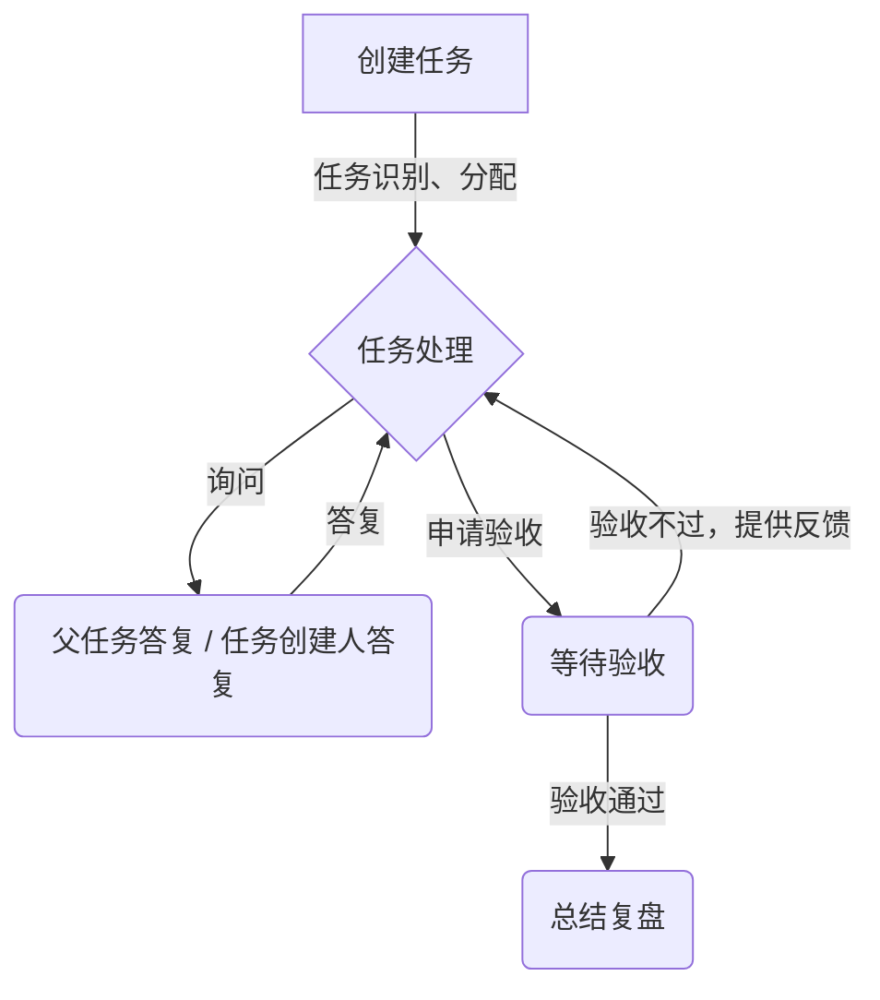
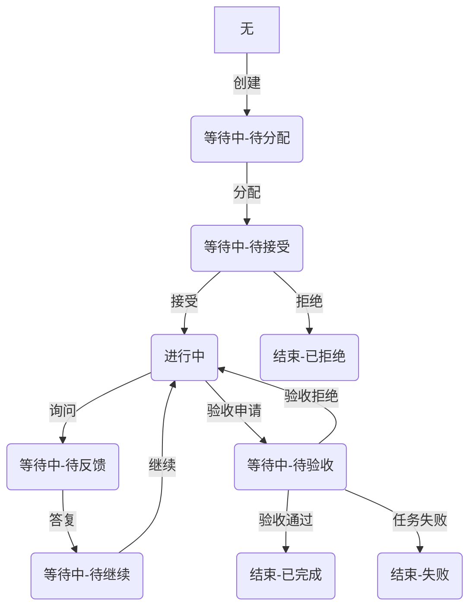

# 任务交付与复盘文档

任务点击`验收` 后，形成 任务 总结移交文档

1. 调用 机器人做自我总结，我总结后的文档，形成 REPORT，并上传到 project 知识库中，并将总结报告返回到聊天记录中
2. 总结报告的命名：task/handoff/{date}/{task-id}/{version}.md  其中 version 从0 开始，没生成一次，加1；date 格式为：yyyyMMdd
3. 任务相关文档统一放在任务目录 `task/{date}/{task-id}/` 下，去掉版本部分（知识路径不带 `.md` 后缀，阅读名为 `X.md`）：
   1. `API.md` 接口文档
   2. `TECH_DESIGN.md` 技术方案文档
   3. `HANDOFF.md` 交付文档
   4. `REVIEW.md` 复盘文档（验收通过后由平台生成）
   5. 需求中明确指定文档地址时，按需求指定的地址写入，不再使用默认任务目录
4. 总结报告要求包含的内容：
   1. 任务的原始输入、任务的整理后的输入
   2. 任务的交付物与结论
   3. 任务的统计数据：用户确认了多少次、补充了多少次信息、持续了多长时间
   4. 任务的记录：中间走了哪些弯路、总结了哪些经验
   5. 总结的经验：总结了哪些经验

---

单任务的任务流

任务的几个关键的定义：

1. 任务需求方 - 提出需求的  人  或者  机器人，需求方可以是人 也可以是 机器人
2. 任务机器人 - 当前执行这个任务的机器人
3. 任务负责人 - 负责这个任务执行的机器人的负责人

任务上升机制，如果任务超过3次无法验收通过，则任务状态交由 任务负责人 来完成

任务交付文档（当前实现）：

1. 任务创建时即创建交付文档，路径固定为 `task/{任务创建日期}/{task-code}/HANDOFF`（阅读名 `HANDOFF.md`），初始正文为 `> 正在处理中……`；同一目录下可用 `GET/POST /api/tasks/{taskId}/documents.md` 维护 `API.md`、`TECH_DESIGN.md` 等普通文档
2. 执行机器人在任务执行过程中通过 `GET /api/tasks/{taskId}/handoff.md` 读取、`POST /api/tasks/{taskId}/handoff/update.md` 更新正文（完整 `content` 或 `append` + `baseVersion`）
3. 正文完全由执行机器人根据任务内容、任务定义和实际进展编写，平台不拼接固定章节；需求方也可在工作台直接编辑
4. 平台在 Frontmatter 维护 `document/task/version/updated_by/update`，每次有效正文变更版本递增；版本冲突返回 409
5. 申请验收只校验正文非占位并锁定当前版本（`tasks.handoffSubmittedVersion`），待验收期间文档锁定；撤销交付或返工后才能继续编辑

---

## 多机器人协同作业

原则：

1. 一个任务 有且只有一个 机器人负责、一个需求方（可以是 人 或者 机器人）
2. 任务来源有两种：人 创建的 或者 机器人分发的
3. 同一时间，一个机器人只能处理一个任务
   1. 如果任务处于 等待状态，可以接受新任务，

任务创建原则：根据 `任务定义` 来判断是否需要创建子任务

任务的状态图更新：

1. task-defines   当前系统支持分发的任务类型
2. task-create 创建子任务
3. task-refuse  任务拒绝，表示这个任务不是我能处理的范围，并给出拒绝理由和分发建议
4. task-fail  任务失败，仅由任务的需求方可以完成
5. task-accept 接受任务
6. task-question-ask  代替opencode的询问，由 project 接管，并展示和判断UI
7. task-question-answer  答复消息，并更改任务状态为
8. task-handoff-apply 任务验收申请
9. task-handoff-accept 任务验收通过
10. task-handoff-refuse 任务验收失败

由LOOP来接手等待中的任务，并驱动进行下一步，需要判断当前机器人的状态，如果是等待，则可以安排，否则继续等待

在写入 AGENTS.md 的时候，需要加上 以上子任务的使用的逻辑，并告诉AGENTS.md 如果有不匹配自己的任务可以在`等待中-待接受`阶段拒绝任务。

---

## 当前已实现说明（2026-11-02）

1. 任务执行成功不会自动进入待验收，执行机器人必须调用 `POST /api/tasks/:id/handoff/apply.md`（`X-Worker-Token`）申请验收；申请不再生成/覆盖 HANDOFF，只校验并锁定任务执行期间已经维护好的交付文档版本。
2. 交付文档在执行过程中持续维护：AI 通过 `handoff/update.md` 提交完整正文或 `append` 增量，平台校验 `baseVersion` 并维护 Frontmatter 版本号；需求方人工修改后，平台把最新版本通知给 AI 执行机器人（执行中进入会话队列，待反馈/待继续并入恢复提示）。
3. `handoff/apply.md` 仍兼容旧的结构化交付说明字段：`delivery`、`problems`、`detours`、`lessons`、`followUps`、`other`，但只作为验收事件与 REVIEW 快照，不再决定 HANDOFF 正文。工作台真人交付不再提交 Markdown 内容，直接确认当前文档版本。
4. `REVIEW` 保留统一目录：`0 任务与责任`、`1 需求说明`、`2 交付内容`、`3 实现问题与解决`、`4 弯路与经验复盘`、`5 遗留建议与后续待办`、`6 其它需要保留的信息`，末尾附任务统计；HANDOFF 章节由执行方自行组织。
5. 申请验收时的交付说明与需求方名称随验收事件留存，REVIEW 生成时作为事实上下文复用，避免重新猜测代码分支、文档清单或问题过程。
5. 需求方通过网页「完成」或 `POST /api/tasks/:id/handoff/accept.md` 验收，通过后异步生成 `REVIEW`；只有任务需求方可以操作。
6. 验收不通过通过网页「验收不通过」或 `POST /api/tasks/:id/reject` 提交反馈，计入 `tasks.acceptRejectCount`。第 1～3 次退回原机器人，第 4 次起转「等待中-待反馈」并记录/通知执行机器人负责人。
7. 任务负责人提交反馈后重新识别并派发机器人；验收计数与接管快照保留。
8. 子任务机器人提问优先由直接父任务机器人自动答复：平台使用父机器人执行器、模型和工位创建一次性独立咨询会话，不干扰父任务执行状态；无可用父机器人或自动答复失败时，通知任务需求方人工回答。
9. 任务详情展示验收不通过次数、负责人接管信息，以及父任务机器人自动答复中/失败状态。
10. 任务文档目录统一为 `/task/{yyyyMMdd}/{任务编号}/`：`HANDOFF.md` 走 `handoff/update.md`；`API.md`、`TECH_DESIGN.md` 等普通文档走 `GET/POST /api/tasks/:id/documents.md`（`name` 支持带/不带 `.md`，同名覆盖）；`REVIEW.md` 由平台验收后生成。`/task/**` 在通用知识接口中只读，禁止绕过任务流程改写。