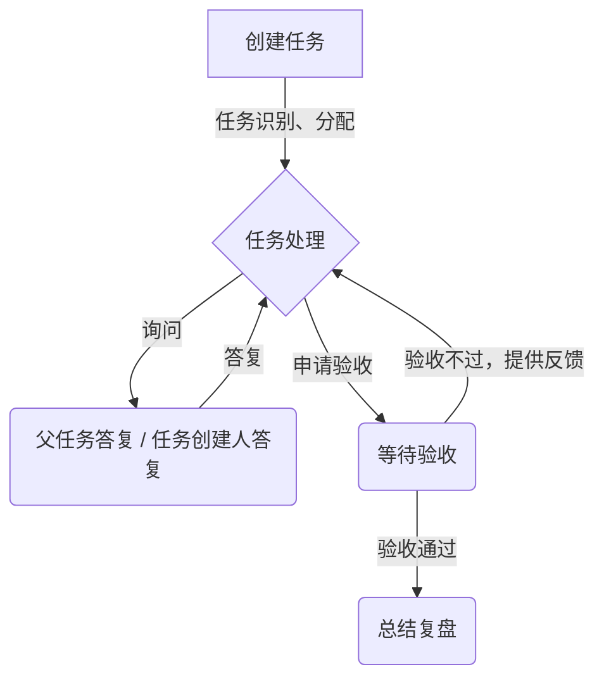

# 任务总结文档

任务点击`验收` 后，形成 任务 总结移交文档

1. 调用 机器人做自我总结，我总结后的文档，形成 REPORT，并上传到 project 知识库中，并将总结报告返回到聊天记录中
2. 总结报告的命名：task/handoff/{date}/{task-id}/{version}.md  其中 version 从0 开始，没生成一次，加1；date 格式为：yyyyMMdd
3. 总结报告要求包含的内容：
   1. 任务的原始输入、任务的整理后的输入
   2. 任务的交付物与结论
   3. 任务的统计数据：用户确认了多少次、补充了多少次信息、持续了多长时间
   4. 任务的记录：中间走了哪些弯路、总结了哪些经验
   5. 总结的经验：总结了哪些经验

---

单任务的任务流

 