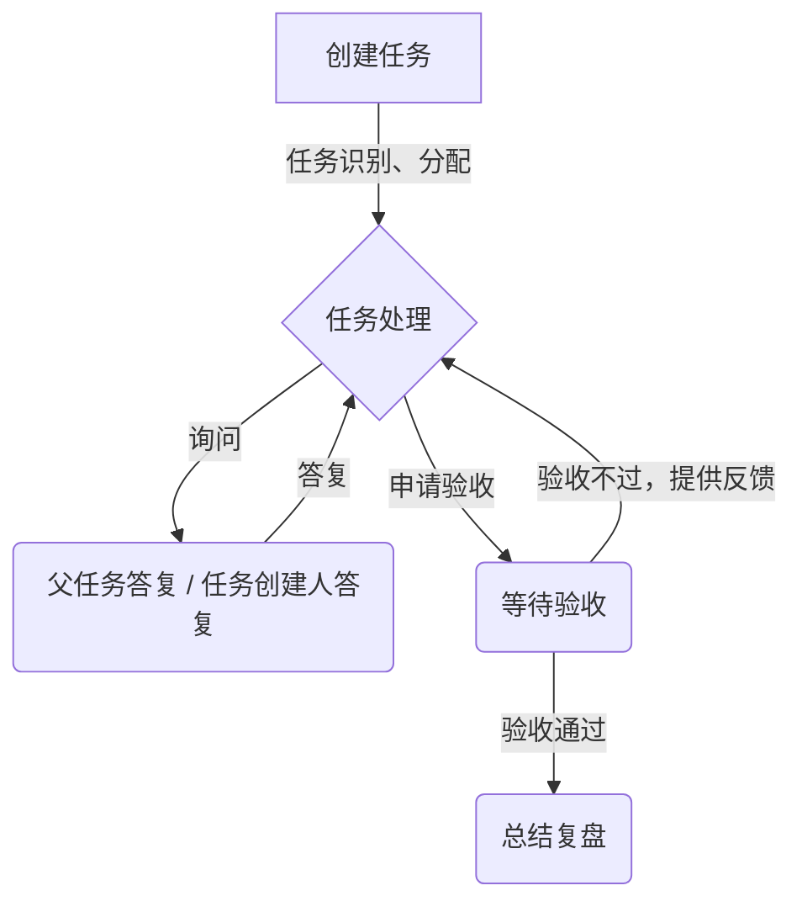
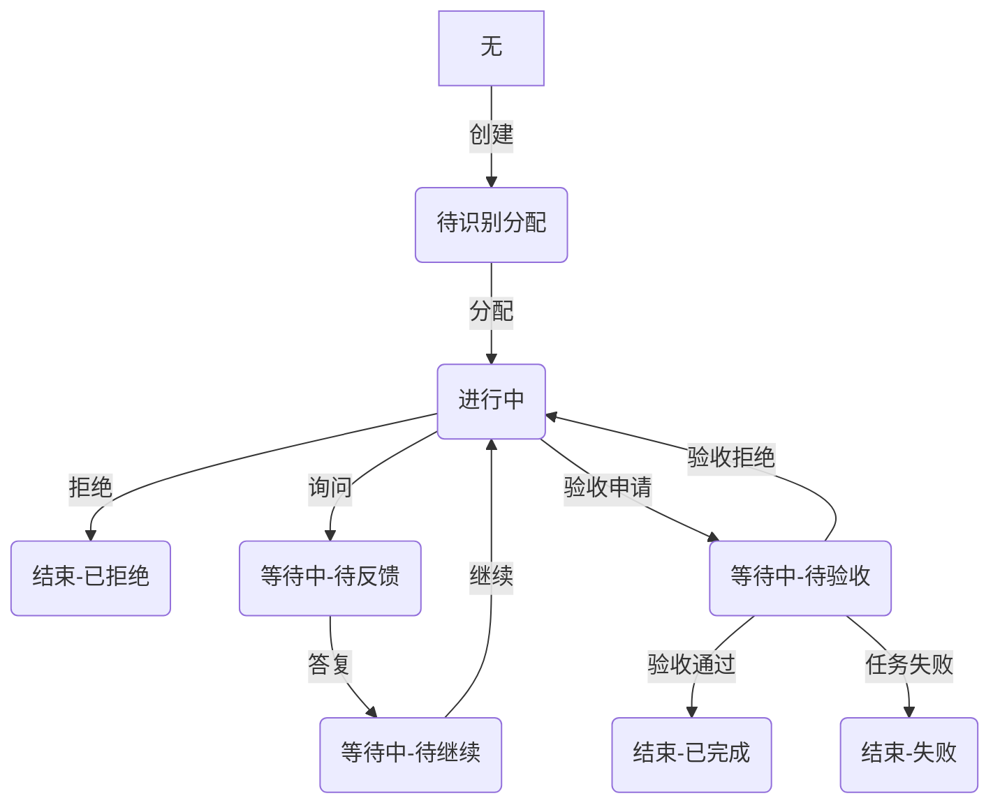

# 任务交付与复盘文档

任务点击`验收` 后，形成 任务 总结移交文档

1. 调用 机器人做自我总结，我总结后的文档，形成 REPORT，并上传到 project 知识库中，并将总结报告返回到聊天记录中
2. 总结报告的命名：task/handoff/{date}/{task-id}/{version}.md  其中 version 从0 开始，没生成一次，加1；date 格式为：yyyyMMdd
3. 任务相关形成的文档重新调整一下命名和路径，且去掉 版本 部分
   1. task/{date}/{task-id}/REVIEW.md  复盘文档
   2. task/{date}/{task-id}/HANDOFF.md  交付文档
4. 总结报告要求包含的内容：
   1. 任务的原始输入、任务的整理后的输入
   2. 任务的交付物与结论
   3. 任务的统计数据：用户确认了多少次、补充了多少次信息、持续了多长时间
   4. 任务的记录：中间走了哪些弯路、总结了哪些经验
   5. 总结的经验：总结了哪些经验

---

单任务的任务流

任务的几个关键的定义：

1. 任务需求方 - 提出需求的  人  或者  机器人，需求方可以是人 也可以是 机器人
2. 任务机器人 - 当前执行这个任务的机器人
3. 任务负责人 - 负责这个任务执行的机器人的负责人

任务上升机制，如果任务超过3次无法验收通过，则任务状态交由 任务负责人 来完成

新增任务交付文档：

1. 任务在执行提交验收时，需要提供一个交付文档，交付文档通过 project 的 文档来创建或者更新
2. 文档的命名格式为：task/deliver/{date}/{task-id}/deliver.md
3. 文档的标题为：{taskid}-{xxxxxx}-交付文档

交付文档创建完成后，可以申请验收（调用 申请验收的接口来实现）

---

## 多机器人协同作业

原则：

1. 一个任务 有且只有一个 机器人负责、一个需求方（可以是 人 或者 机器人）
2. 任务来源有两种：人 创建的 或者 机器人分发的
3. 同一时间，一个机器人只能处理一个任务
   1. 如果任务处于 等待状态，可以接受新任务，

根据 `任务定义` 来判断是否需要创建子任务

提供一组给 AI AGENT 的接口：

任务的状态图更新：

1. task-defines   当前系统支持分发的任务类型
2. task-refuse  任务拒绝，表示这个任务不是我能处理的范围，并给出拒绝理由和分发建议
3. task-accept
4. task-question-ask  代替opencode的询问，由 project 接管，并展示和判断UI
5. task-question-answer  答复消息，并更改任务状态为