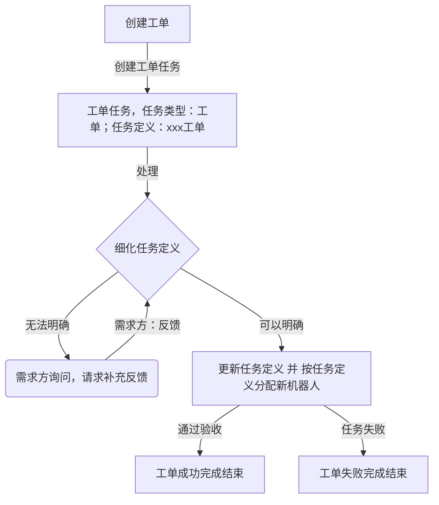

# 工单

在导航栏的顶部，增加：`工单` ，子导航栏分别为：

- 方案工单 - 针对方案的设计的工单
- 技术工单（先不实现） - 业务同学向技术同学申请完成某个任务
- 数据工单（先不实现） - 业务同学向技术同学申请完成某个技术的任务，主要：数据查询、数据导出、报表设计等
- 运维工单（先不实现） - 线上操作提出申请，包括：数据库操作、NACOS操作、
- 需求工单（先不实现） - 业务同学向产品同学提出需求申请
- BUG反馈（先不实现） - 线上的故障反馈工单

## 工作流

先实现一个简单的工作流，创建工单时，需要提供工单的`负责人 或者 机器人`，

## 任务定义

工单默认对应一个工作定义：

- 方案工单 - ID=10，`工单-方案工单-调度`，实现工单的流转
- 技术工单 - ID=11，`工单-技术工单-调度`，实现工单的流转
- 数据工单 - ID=12，`工单-数据工单-调度`，实现工单的流转
- 运维工单 - ID=13，`工单-运维工单-调度`，实现工单的流转
- 需求工单 - ID=14，`工单-需求工单-调度`，实现工单的流转
- BUG反馈 - ID=15，`工单-BUG工单-调度`，实现工单的流转

每个工单下面，可以配置多个后续可以变更的任务定义，可以在工单的配置也来配置（放在 管理 的导航下）
