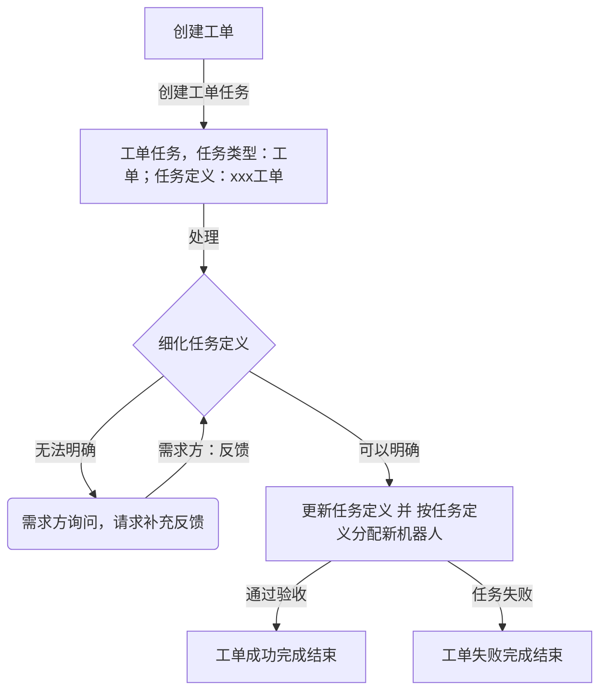

# 工单

在导航栏的顶部，增加：`工单` ，子导航栏分别为：

- 方案工单 - 针对方案的设计的工单
- 技术工单（先不实现） - 业务同学向技术同学申请完成某个任务
- 数据工单（先不实现） - 业务同学向技术同学申请完成某个技术的任务，主要：数据查询、数据导出、报表设计等
- 运维工单（先不实现） - 线上操作提出申请，包括：数据库操作、NACOS操作、
- 需求工单（先不实现） - 业务同学向产品同学提出需求申请
- BUG反馈（先不实现） - 线上的故障反馈工单

## 工作流

先实现一个简单的工作流，创建工单时，需要提供工单的`负责人 或者 机器人`，

## 任务定义

旧调度模型已退役：工单不再按类别绑定默认调度任务定义，曾经的六个系统任务定义（ID 10-15，`工单-{方案/技术/数据/运维/需求}工单-调度`、`工单-BUG工单-调度`）已由迁移 `1796200000000-remove-ticket-dispatch-templates` 删除。

工单节点（审批/操作）现在直接绑定普通任务定义，机器人按定义自动分配；历史工单与节点运行的 `templateId/templateName` 快照保留，仅作展示。

## 工单工作流

### 工单的模型

1. 每个工单，有一个发起机器人，为发起工单的人
2. 工单的节点，有四类：
   1. 起始 节点，每个工单有且只有一个，表示任务的起始，机器人为发起机器人，不需要任务定义，需要定义输入的所需字段和类型
   2. 审批 节点，配置时，任务定义 为必选，负责机器人为必选
   3. 操作 节点，配置时，任务定义 为必选，任务创建时自动分配机器人
   4. 验收 节点，每个工单有且只有一个，只能由 发起机器人来验收，不需要任务定义，增加一个配置：自动验收，表明不需要手动点击即可完成验收。
3. 交互优化：
   1. 根据 流转规则 的实时配置，生成 一个 流程图，以便于快速工作流
4. 工单配置 与 工单定义 合并
   1. 去掉 原 工单配置，原工单定义 改为 工单配置
   2. 顶部导航里面的 工单，改为最新使用工作流的工单，左侧的导航 为 配置的工单列表

---

### 上线材料审查

设计一个任务定义和对应的机器人：`技术-上线材料审查` 任务定义 和 `技术-材料审查机器人` 

#### 任务：`技术-上线材料审查`

- 它负责针对上线的材料进行审查，对于缺失的部分进行反馈和要求补充，对于缺失特别多的直接标记任务拒绝，打回处理
- 输入是 上线申请材料，需要明确：
  - 需求，可以是需求文档 或者 是需求描述
  - 提测单（可选），当前代码都有哪些提测单
  - 上线步骤，每一步为一个操作项
    - 代码发布，需要提供仓库和分支
    - 数据库操作，需要提供具体的SQL
    - NACOS操作，需要提供 具体的 namespace、group、dataid、配置格式、正文 ，需要明确是：修改、新增、删除
- 需要处理：
  - 针对 提供材料的有效性进行核验
  - 针对 SQL 进行语法检查 以及 影响范围评估
  - 需要 针对 nacos 的语法检查 以及 影响范围评估
- 输出是 上线申请材料的整理 以及 影响范围评估

#### 机器人：  `技术-材料审查机器人` 

- 当前任务是机器人做材料审查的其中一项任务
- 材料 如果部分缺失，可以要求补充；如果缺失过多，则直接拒绝任务
- 材料 进行整理，作为任务的输出

